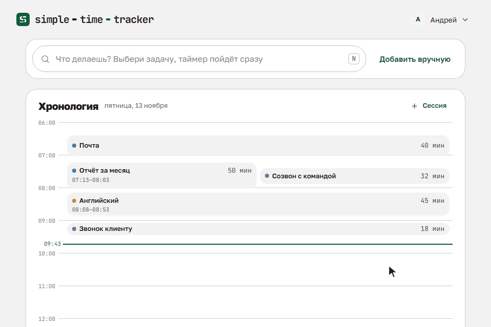

<p align="center">
  <picture>
    <source media="(prefers-color-scheme: dark)" srcset=".github/readme/logo-dark.svg">
    
  </picture>
</p>

<p align="center">
  Простой бесплатный трекер времени с открытым кодом: таймеры по задачам и проектам, вход через Telegram, синк с Notion.
</p>

<p align="center">
  <a href="https://timetracker.complewin.ru">Открыть трекер</a> ·
  <a href="docs/self-hosting.md">Свой экземпляр</a> ·
  <a href="LICENSE">Лицензия MIT</a>
</p>

<p align="center">
  
</p>

## Что это

Задачи собраны в проекты, у каждой свой таймер, несколько таймеров могут идти одновременно. Каждый запуск таймера сохраняется как сессия с заметкой, сессии можно править вручную.

- Вход через Telegram, без пароля и почты.
- Синк с Notion: задачи приходят из баз Notion. По желнию можно сделать, чтобы время по ним писалось обратно на страницы.
- Telegram-бот может запускать и останавливать таймеры командами и напоминать о таймере, который идёт слишком долго.
- Трекер ставится на телефон и компьютер как приложение (PWA). Таймер, запущенный на одном устройстве, виден на другом.

## Открытый код

Код открыт под лицензией MIT. Есть три пути:

- пользоваться готовым проектом;
- развернуть только для себя: [docs/self-hosting.md](docs/self-hosting.md);
- дописать свою фичу и предложить её в этот репозиторий: [CONTRIBUTING.md](CONTRIBUTING.md).

## Как устроено

Трекер живёт на Cloudflare: один Worker отдаёт и API, и фронтенд, данные лежат в базе D1. Репозиторий собран из npm workspaces:

```
apps/api         Cloudflare Worker на Hono, база D1 через Drizzle, cron для синка и напоминаний
apps/web         фронтенд на Vue 3, Vite, Vue Router, Pinia и vue-i18n
packages/shared  общие типы, zod-схемы, словари ru и en, чистые функции
```

Окружений два, оба описаны в `apps/api/wrangler.jsonc`:

| Окружение    | Worker           | База D1          | Как выкатывается                                          |
| ------------ | ---------------- | ---------------- | --------------------------------------------------------- |
| `production` | `stt-production` | `stt-production` | вручную, workflow "Deploy production"                     |
| `staging`    | `stt-staging`    | `stt-staging`    | сам после каждого push в `main`, если задан адрес staging |

Staging нужен, чтобы проверить изменения до production.

Адреса и контакты в файлах не записаны. Их задают переменные репозитория на GitHub, поэтому форку не нужно править код.

## Свой экземпляр

Пошаговая инструкция для форка лежит в [docs/self-hosting.md](docs/self-hosting.md). Она рассчитана на тех, кто раньше не работал с Cloudflare: форк, база D1, свой бот, подключение Notion, секреты, первая выкатка, свой домен, обновление, бэкап и откат. Хватит бесплатного аккаунта Cloudflare, свой домен не обязателен.

## Разработка и доработки

Команды, локальный запуск, тесты и порядок, как предложить PR, описаны в [CONTRIBUTING.md](CONTRIBUTING.md). Правила кода для ИИ-агентов собраны в [AGENTS.md](AGENTS.md).

## План развития

- [ ] Вебхуки Notion вместо опроса: изменения из Notion приходят в трекер сразу.
- [ ] Отчёты за неделю и месяц, экспорт сессий в CSV.
- [ ] Офлайн-очередь в PWA: действия без сети сохраняются и уходят на сервер, когда связь вернётся.
- [ ] Telegram Mini App: трекер внутри Telegram на том же фронтенде.
- [ ] Синк через Cloudflare Queues и Durable Objects

Есть идея или хочешь взять пункт в работу: открой issue, порядок описан в [CONTRIBUTING.md](CONTRIBUTING.md).

## Лицензия

MIT, текст в файле [LICENSE](LICENSE).
